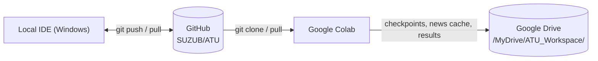
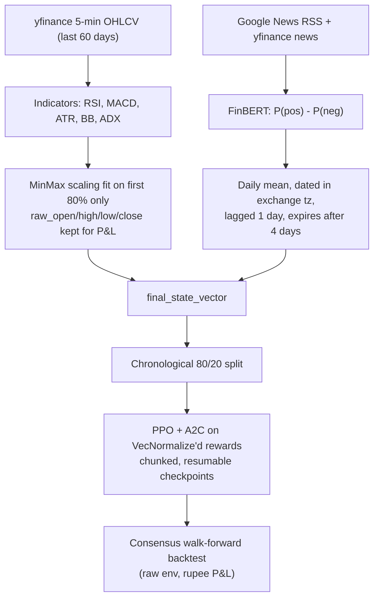

# ATU - Automated Trading Unit: Intraday Reinforcement Learning System

An intraday RL trading system built with **Stable-Baselines3 (PPO + A2C ensemble)**, **Gymnasium**, and **FinBERT** news sentiment. It trains on **real 5-minute candles** (yfinance) and **real recent headlines** (Google News RSS + yfinance news), with realistic intraday frictions: square-off before the close, -1% stop-loss with gap slippage, a 3-trade daily cap and per-leg brokerage.

---

## 1. Project Structure

```text
XD/
├── ATU_GPU.ipynb               # Colab notebook (cells 3-4 call src/train.py)
├── notebooks/
│   ├── ATU_GPU.ipynb           # Identical copy of the Colab notebook
│   └── training.ipynb          # Small local walkthrough on generated demo data
├── src/
│   ├── data_processing.py      # Archive loader, demo data generator, re-exports
│   ├── model.py                # Env / PPO factory helpers
│   └── train.py                # THE pipeline: data -> features -> training -> backtest + CLI
├── market_data_processor.py    # File 1: OHLCV, indicators, leak-free scaling, news fetcher, sentiment merge
├── sentiment_processor.py      # File 2: FinBERT scoring
├── constrained_trading_env.py  # File 3: Gymnasium trading environment
├── train_and_backtest.py       # File 4: CLI entry point (thin wrapper over src/train.py)
└── requirements.txt
```

The CLI and the notebook run the **same functions** in `src/train.py`, so they cannot drift apart.

---

## 2. Workflow



Workspace layout (local folder or Drive):

| Folder | Contents |
| :--- | :--- |
| `datasets/` | `news_cache_<TICKER>.csv` (accumulated headlines) |
| `checkpoints/` | `ppo_trading_agent_v1.zip`, `a2c_trading_agent_v1.zip`, `*_vecnormalize.pkl` |
| `training_logs/` | TensorBoard logs |
| `results/` | `evaluation_metrics.json`, `backtest_portfolio_history.csv`, `backtest_report.txt`, `equity_curve.png` |

---

## 3. Pipeline



- **No synthetic data in the pipeline.** A failed price download raises an error.
- **No look-ahead:** scaler fit on the training slice only; sentiment from day D is first used on day D+1.

---

## 4. Environment Rules (`ConstrainedTradingEnv`)

| Rule | Implementation |
| :--- | :--- |
| **Actions** | `Discrete(3)`: 0 = Short, 1 = Flat, 2 = Long (target position) |
| **Observation** | Scaled market features + unrealized P&L, position direction, time of day, trades remaining, lockout flag |
| **Reward** | Net rupee P&L of the step (equity change, fees included). Normalized only during training via `VecNormalize` |
| **Position size** | `balance x max_risk_per_trade / abs(loss_limit)` (1x with defaults), fixed while held |
| **Fees** | 0.03% of traded notional on entry and on exit |
| **Stop-loss** | -1% from entry. Detected on the candle high/low; fills at the stop price, or at the open if the candle gapped through it. Locks the agent out for the rest of the day |
| **Square-off** | NSE/BSE (`.NS`/`.BO`): session 09:15-15:30 IST, square-off 15:15. US: 09:30-16:00 ET, square-off 15:45 |
| **Daily cap** | Max 3 entries per day |
| **Episode** | One unbroken episode over the whole dataset; terminates only at the last bar |

---

## 5. Local Development

```powershell
python -m venv .venv
.\.venv\Scripts\Activate.ps1
pip install -r requirements.txt

# Smoke test (real data, tiny training)
python train_and_backtest.py --ticker AAPL --timesteps 4096 --chunks 2

# Full run
python train_and_backtest.py --ticker RELIANCE.NS --timesteps 500000
```

Key CLI options (`python train_and_backtest.py --help`):

| Flag | Default | Meaning |
| :--- | :--- | :--- |
| `--ticker` | `AAPL` | yfinance symbol (`RELIANCE.NS` for NSE) |
| `--workspace` | `ATU_Workspace` | Output folder (alias: `--model-save-path`) |
| `--timesteps` | `500000` | Training steps **per agent** |
| `--chunks` | `10` | Checkpoint chunks per agent |
| `--device` | `auto` | FinBERT device |
| `--news-query` | company + symbol | Override news search queries (repeatable) |
| `--no-finbert` | off | Neutral sentiment |
| `--require-sentiment` | off | Fail if no bar gets real sentiment |
| `--include-archive` | off | Also scan old archive CSVs in `datasets/` |
| `--no-tensorboard` | off | Disable TensorBoard logs |

---

## 6. Google Colab

1. Open `ATU_GPU.ipynb` from `https://github.com/SUZUB/ATU` in Colab and select a GPU runtime (used by FinBERT; the small SB3 agents train on CPU).
2. **Cell 1** clones/pulls the repo, installs requirements and mounts Drive.
3. **Cell 2** imports the shared pipeline.
4. **Cell 3** builds the real-data state vector. Change `TICKER` here.
5. **Cell 4** trains PPO + A2C (10 x 50k steps each, resumes from Drive), runs the backtest and saves results.

Equivalent CLI inside Colab:
```bash
!python train_and_backtest.py --ticker AAPL --workspace /content/drive/MyDrive/ATU_Workspace
```

---

## 7. Reading the Report

The backtest report includes net/gross P&L, fees, trade-level win rate and profit factor, drawdown, Sharpe/Sortino, and the **signal mix** of each agent. A `WARNING: ... collapsed` line means an agent outputs the same signal on >95% of test bars, i.e. it ignores the market state; treat that run's results as uninformative.

**Caveat:** yfinance only provides 60 days of 5-minute data, so the test window is about 12 trading days. Backtest figures on such a short window are anecdotal.
