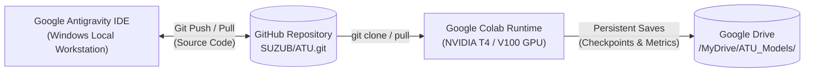
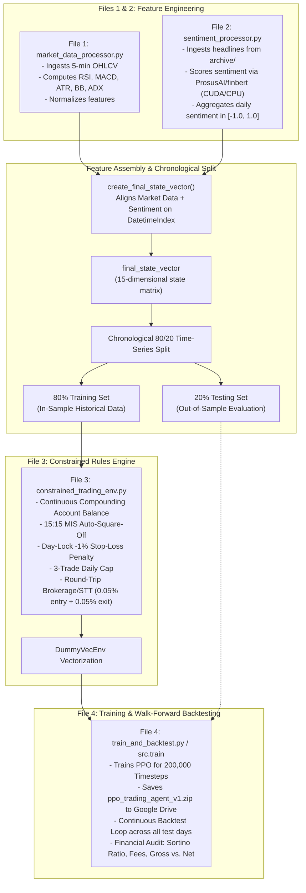

# ATU - Automated Trading Unit: Intraday Reinforcement Learning System

A modular, production-ready Reinforcement Learning trading system built with **Stable-Baselines3 (PPO)**, **Gymnasium**, and **Hugging Face Transformers (FinBERT)**, designed specifically for intraday 5-minute stock market data with realistic **Margin Intraday Square-off (MIS)** frictions and continuous capital compounding.

---

## 1. Project Directory Structure

```text
XD/
├── ATU_GPU.ipynb                      # Google Colab GPU execution notebook (turnkey)
├── notebooks/                         # Interactive exploratory & visualization notebooks
│   ├── training.ipynb                 # End-to-end local training & backtesting walkthrough
│   └── ATU_GPU.ipynb                  # Colab GPU execution notebook copy
├── src/                               # Core modular package
│   ├── __init__.py
│   ├── data_processing.py             # Feature ingestion, technical indicators & sentiment
│   ├── model.py                       # Gymnasium trading environment & PPO agent factory
│   └── train.py                       # Pipeline runner (80/20 split, 200k steps, backtesting)
├── archive/                           # Historical financial news headlines & analyst ratings
│   ├── analyst_ratings_processed.csv
│   ├── raw_analyst_ratings.csv
│   └── raw_partner_headlines.csv
├── constrained_trading_env.py         # File 3: The Gymnasium rules engine (MIS, taxes, stop-loss)
├── market_data_processor.py           # File 1: Fetches 5-min OHLCV and technical indicators
├── sentiment_processor.py             # File 2: Fetches and scores FinBERT news sentiment
├── train_and_backtest.py              # File 4: The main root execution script that runs everything
├── requirements.txt                   # Project dependency manifest
├── .gitignore                         # Comprehensive Git ignore rules (secrets, venvs, datasets)
└── README.md                          # Complete architecture & deployment documentation
```

---

## 2. Hybrid Workflow: Antigravity IDE + GitHub + Google Colab GPU

This repository supports a production-grade split-tier machine learning development workflow:



| Environment | Role | Hardware / Services |
| :--- | :--- | :--- |
| **Google Antigravity IDE** | Primary development, code editing, rapid prototyping, unit tests | Local Windows Workstation, CPU / local GPU |
| **GitHub (`SUZUB/ATU.git`)** | Source code versioning & cross-platform synchronization | Remote Git Repository |
| **Google Colab** | Accelerated training execution (`ATU_GPU.ipynb`) | NVIDIA T4 / V100 / A100 GPU |
| **Google Drive** | Persistent model weight storage & evaluation history | `/content/drive/MyDrive/ATU_Models/` |

---

## 3. Sequential Data Pipeline Flow



---

## 4. Real-World Market Frictions & Constraints

| Constraint / Rule | Implementation Mechanics |
| :--- | :--- |
| **Continuous Compounding** | Net PnL is permanently added to `self.account_balance` upon trade closure. Capital risk scales dynamically with live balance. |
| **3-Trade Daily Cap** | Limits order placement to at most 3 entries per calendar day. Overtrading attempts (`\|action\| > 0.1`) are overridden to `0.0` (Hold) with a `-0.1` penalty. |
| **Round-Trip Brokerage & STT** | Parameterized at `0.0005` (0.05%). Deducted **twice** per trade: once on the entry leg, and once on the exit leg. |
| **15:15 MIS Auto-Square-Off** | At or past `15:15:00`, open positions are forcefully closed, exit fees are deducted, balance is compounded, and the agent remains flat until the next morning (`09:15:00`) without terminating the episode. |
| **Day-Lock Stop-Loss Penalty** | When open loss reaches $\le -1\%$, the position is closed, exit fees are deducted, and `self.locked_out_for_day = True` overrides all actions to `0.0` (Hold) until the next date rollover. |
| **Unbroken Episode Horizon** | The environment **ONLY** sets `terminated = True` at the absolute end of the dataset (`self.current_step >= len(self.df) - 1`). |

---

## 5. Local Development (Google Antigravity IDE on Windows)

### 5.1 Environment Setup
```powershell
# Create and activate virtual environment
python -m venv .venv
.\.venv\Scripts\Activate.ps1

# Install dependencies
pip install -r requirements.txt
```

### 5.2 Local Execution
Run File 4 using the CLI with customizable parameters:
```powershell
# Full 200,000 steps training & backtest
python train_and_backtest.py --timesteps 200000 --device auto

# Quick 5,000 steps local smoke test
python train_and_backtest.py --timesteps 5000 --device cpu
```

Or run via the modular package:
```powershell
python -m src.train --timesteps 5000 --device auto
```

Or open the interactive local notebook:
```powershell
jupyter notebook notebooks/training.ipynb
```

---

## 6. GitHub Synchronization

The repository is configured with the remote:
`https://github.com/SUZUB/ATU.git`

### 6.1 Check Status & Remote
```powershell
git status
git remote -v
```

### 6.2 Commit & Push Code Changes
> **Security Note:** Raw datasets (`archive/`), virtual environments (`.venv/`), checkpoints (`*.zip`), and secrets (`.env`) are strictly excluded via `.gitignore`.

```powershell
# Stage code modifications
git add .gitignore README.md requirements.txt ATU_GPU.ipynb
git add market_data_processor.py sentiment_processor.py constrained_trading_env.py train_and_backtest.py
git add src/ notebooks/

# Commit changes
git commit -m "Configure ATU for Google Colab GPU training with Google Drive persistence"

# Push to GitHub (Requires authorization)
git push -u origin main
```

---

## 7. Google Colab GPU Execution

### 7.1 Launching in Google Colab
1. Open Google Colab: [https://colab.research.google.com/](https://colab.research.google.com/)
2. Select **GitHub** tab and enter: `https://github.com/SUZUB/ATU.git`
3. Open `ATU_GPU.ipynb`.
4. Enable GPU Hardware Acceleration:
   - Click **Runtime** > **Change runtime type**
   - Under **Hardware accelerator**, select **T4 GPU**
   - Click **Save**

### 7.2 Notebook Workflow Steps (`ATU_GPU.ipynb`)
1. **Environment & Python Checks:** Validates Python version and operating system.
2. **GPU Detection:** Runs `torch.cuda.is_available()` and `!nvidia-smi` to verify VRAM allocation.
3. **Google Drive Mount:**
   ```python
   from google.colab import drive
   drive.mount('/content/drive')
   ```
   Initializes `/content/drive/MyDrive/ATU_Models/` for persistent checkpoint storage.
4. **Repository Cloning & Updates:**
   ```bash
   !git clone https://github.com/SUZUB/ATU.git /content/ATU
   %cd /content/ATU
   !git pull origin main
   ```
5. **Dependency Installation:**
   ```bash
   !pip install -q -r requirements.txt
   ```
6. **Project Initialization:** Imports and validates all 4 pipeline components.
7. **Dataset Loading:** Verifies headlines and 5-min candle generation.
8. **Training Execution (CLI Entry Point):**
   ```bash
   !python train_and_backtest.py \
       --timesteps 200000 \
       --ticker AAPL \
       --device cuda \
       --model-save-path "/content/drive/MyDrive/ATU_Models/ppo_trading_agent_v1"
   ```
9. **Interactive Evaluation:** Direct programmatic evaluation with equity curves and Sortino ratio audit.
10. **Drive Persistence Verification:** Confirms `.zip` model checkpoint exists in `/content/drive/MyDrive/ATU_Models/`.
11. **Local Download:** Optional browser-based download using `google.colab.files.download`.

---

## 8. Financial Performance Audit Report Example

```text
======================================================================
             INTRADAY BACKTEST PERFORMANCE REPORT               
======================================================================
 Initial Account Balance:        ₹100,000.00
 Final Compounded Balance:       ₹103,450.00
 Total Days Processed:           12 days (900 candles)
 Total Trades Executed:          24 trades (max 3/day)
 Profitable Closed Trades (>2%): 5 trades
 Total Brokerage & STT Paid:     ₹2,400.00 (Round-trip)
 Gross Profit (Before Fees):     ₹+5,850.00 (+5.85%)
 Net Profit (After Fees):        ₹+3,450.00 (+3.45%)
 Sortino Ratio (Ann. 252d):      1.8420
 Continuous Episode Status:      Completed Entire Test Horizon (True)
======================================================================
```
