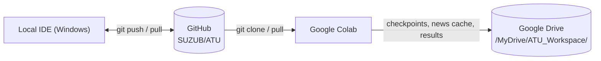
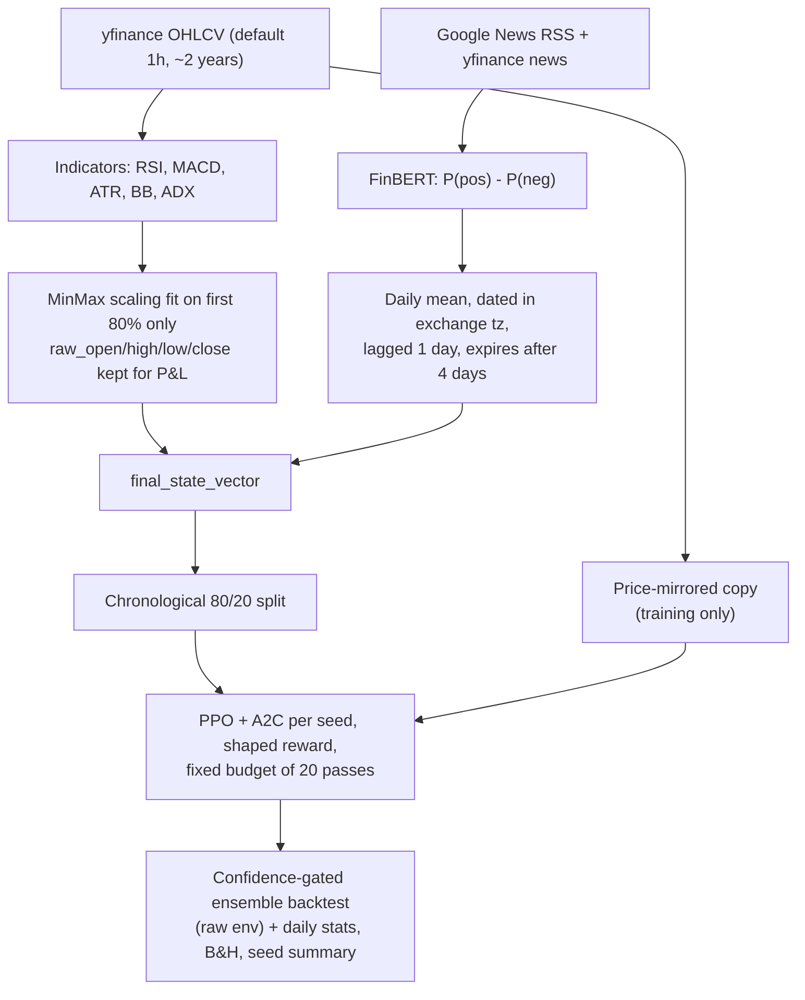

# ATU - Automated Trading Unit: Intraday Reinforcement Learning System

An intraday RL trading system built with **Stable-Baselines3 (PPO + A2C ensemble)**, **Gymnasium**, and **FinBERT** news sentiment. It trains on **real candles** (yfinance; default 1-hour bars over ~2 years) and **real headlines** (Google News RSS + yfinance news), with realistic intraday frictions and risk controls: square-off before the close, ATR-based stops with volatility sizing, trailing stop / take-profit, a daily loss cap, a 3-trade daily cap and per-leg fees.

---

## 1. Project Structure

```text
XD/
├── ATU_GPU.ipynb               # Colab notebook (cells 3-4 call src/train.py)
├── notebooks/
│   ├── ATU_GPU.ipynb           # Identical copy of the Colab notebook
│   └── training.ipynb          # Small local walkthrough on generated demo data
├── src/
│   ├── data_processing.py      # Archive loader, demo data generator, re-exports
│   ├── model.py                # Env / PPO factory helpers
│   └── train.py                # THE pipeline: data -> features -> training -> backtest + CLI
├── market_data_processor.py    # File 1: OHLCV, indicators, leak-free scaling, news fetcher, sentiment merge
├── sentiment_processor.py      # File 2: FinBERT scoring
├── constrained_trading_env.py  # File 3: Gymnasium trading environment
├── train_and_backtest.py       # File 4: CLI entry point (thin wrapper over src/train.py)
└── requirements.txt
```

The CLI and the notebook run the **same functions** in `src/train.py`, so they cannot drift apart.

---

## 2. Workflow



Workspace layout (local folder or Drive):

| Folder | Contents |
| :--- | :--- |
| `datasets/` | `news_cache_<TICKER>.csv` (accumulated headlines) |
| `checkpoints/seed_<n>/` | `ppo_trading_agent_v2.zip`, `a2c_trading_agent_v2.zip`, `*_vecnormalize_v2.pkl` |
| `training_logs/` | TensorBoard logs |
| `results/` | `seed_summary.txt/json`, `equity_by_seed.png`; per seed in `seed_<n>/`: `backtest_report.txt`, `evaluation_metrics.json`, `daily_pnl.csv`, `backtest_portfolio_history.csv`, `equity_curve.png` |

---

## 3. Pipeline



- **No synthetic data in the pipeline.** A failed price download raises an error.
- **No look-ahead:** scaler fit on the training slice only; sentiment from day D is first used on day D+1.
- **No direction bias:** each agent also trains on a mirrored price history (every return negated), so "always long" or "always short" cannot score.
- **No memorization by repetition:** a fixed budget of 20 passes over the training data, fresh models every run (`--resume` to continue).

---

## 4. Environment Rules (`ConstrainedTradingEnv`)

| Rule | Implementation |
| :--- | :--- |
| **Actions** | `Discrete(3)`: 0 = Short, 1 = Flat, 2 = Long (target position) |
| **Observation** | Scaled market features + unrealized P&L, position direction, time of day, trades remaining, lockout flag |
| **Reward** | Shaped (default): step net P&L, minus 0.5x each deepening of the day's max drawdown, +/-0.05% of equity for a green/red day. Staying flat is free. `reward_mode="pnl"` = plain P&L. Normalized only during training via `VecNormalize` |
| **Stop (1R)** | 2 x ATR(14) / price, clipped to 0.3%-2%. Detected on the candle high/low; fills at the stop, or at the open if the candle gapped through it. A **losing** stop locks the agent out for the rest of the day |
| **Position size** | `equity x 0.5% / 1R`, capped at 1x, so a stop costs ~0.5% of equity |
| **Trailing / take-profit** | From +1R the stop trails the best price at 1R (break-even first); take-profit at +3R |
| **Daily loss cap** | At -1% of the day's starting equity: close and stop trading until the next session |
| **Churn control** | Min holding time and re-entry cooldown (~15 min on 5m bars, 1 bar on 1h) |
| **Fees** | 0.03% of traded notional on entry and on exit |
| **Square-off** | NSE/BSE (`.NS`/`.BO`): session 09:15-15:30 IST, square-off 15:15. US: 09:30-16:00 ET, square-off 15:45. Always flat at the close of each day's last bar |
| **Daily cap** | Max 3 entries per day |
| **Episode** | One unbroken episode over the whole dataset; terminates only at the last bar |

---

## 5. Local Development

```powershell
python -m venv .venv
.\.venv\Scripts\Activate.ps1
pip install -r requirements.txt

# Smoke test (real data, tiny training, one seed, no news)
python train_and_backtest.py --ticker AAPL --passes 1 --seeds 0 --no-news

# Full run (1h bars over ~2 years, 3 seeds x 20 passes)
python train_and_backtest.py --ticker AAPL
```

Key CLI options (`python train_and_backtest.py --help`):

| Flag | Default | Meaning |
| :--- | :--- | :--- |
| `--ticker` | `AAPL` | yfinance symbol (`RELIANCE.NS` for NSE) |
| `--workspace` | `ATU_Workspace` | Output folder (alias: `--model-save-path`) |
| `--interval` / `--period` | `1h` / `730d` | Bar size and history (`5m` is limited to `60d`) |
| `--passes` | `20` | Training passes over the (original + mirrored) training data, per agent |
| `--seeds` | `0 1 2` | One independently trained ensemble per seed |
| `--chunks` | `5` | Checkpoint chunks per agent |
| `--no-mirror` | off | Train without the mirrored price copy |
| `--resume` | off | Continue from checkpoints instead of fresh models |
| `--device` | `auto` | FinBERT device |
| `--news-query` | company + symbol | Override news search queries (repeatable) |
| `--no-finbert` | off | Neutral sentiment |
| `--no-news` | off | Price data only: skip news fetching and FinBERT (notebook: `USE_NEWS_SENTIMENT = False`) |
| `--require-sentiment` | off | Fail if no bar gets real sentiment |
| `--include-archive` | off | Also scan old archive CSVs in `datasets/` |
| `--no-tensorboard` | off | Disable TensorBoard logs |

---

## 6. Google Colab

1. Open `ATU_GPU.ipynb` from `https://github.com/SUZUB/ATU` in Colab and select a GPU runtime (used by FinBERT; the small SB3 agents train on CPU).
2. **Cell 1** clones/pulls the repo, installs requirements and mounts Drive.
3. **Cell 2** imports the shared pipeline.
4. **Cell 3** builds the real-data state vector. Change `TICKER`, `INTERVAL`, `PERIOD` here.
5. **Cell 4** trains one PPO + A2C ensemble per seed (`SEEDS`, `TRAIN_PASSES`), backtests each and prints the per-seed reports and the cross-seed summary.

Equivalent CLI inside Colab:
```bash
!python train_and_backtest.py --ticker AAPL --workspace /content/drive/MyDrive/ATU_Workspace
```

---

## 7. Reading the Report

Each seed's report includes net/gross P&L, fees, trade-level win rate and profit factor, exit types (stop / trail / take-profit / daily cap), drawdown, Sharpe/Sortino, the **buy & hold** return over the same window, **green / red / flat days**, sub-window returns and each agent's **signal mix**. A `WARNING: ... collapsed` line means an agent outputs the same signal on >95% of test bars.

The **seed summary** compares the seeds: a real edge is profitable in most seeds and holds up across sub-windows; one good seed is luck.

**Caveat:** with 1h bars the test window is ~145 trading days; with 5m bars (60 days max) it is only ~12 days and results are anecdotal. Past backtests do not guarantee future profit.
